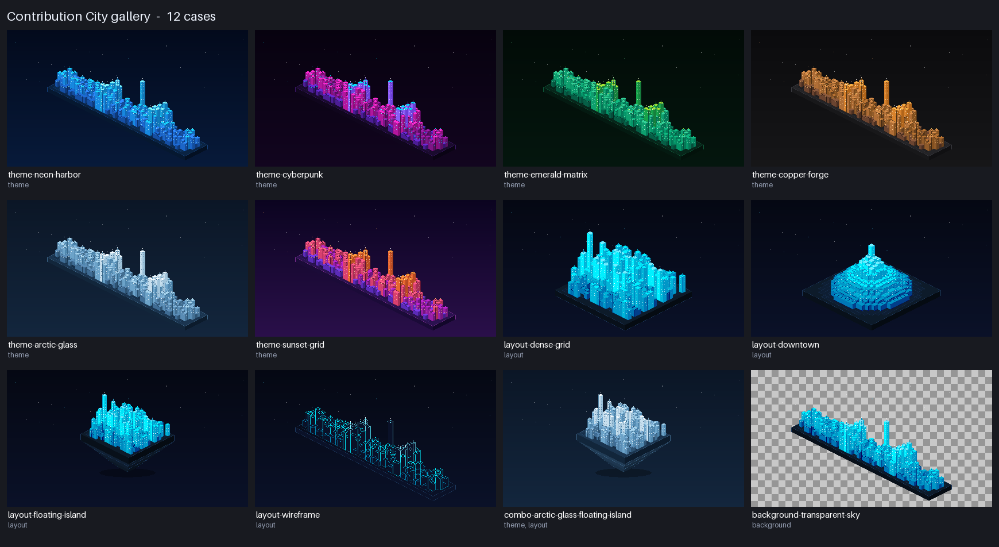

# Contribution City

[](https://github.com/partialHuman/contribution-city/actions)
[](LICENSE)
[](pyproject.toml)

Turn your GitHub contribution activity into an isometric pixel-art city, rendered as one small,
deterministic SVG for profile READMEs and dashboards. Each day is a building; busy days grow into
towers with lit windows and rooftop beacons.

<p align="center">
  
</p>

> **Version note:** this working tree is the 1.2.0 development version. The published release is
> 1.1.0. See [CHANGELOG.md](CHANGELOG.md) and [Upgrading from 1.1.0](#upgrading-from-110).

## Install

```bash
git clone https://github.com/partialHuman/contribution-city
cd contribution-city
python -m pip install -e ".[dev]"      # tests, lint and the visual tools
# or, just the tool:  python -m pip install -e .
```

Python 3.10 or newer. The only runtime dependency is `pyyaml`. The visual tools (`gallery`,
`visual`) need the optional `visual` extra (`resvg-py`, `Pillow`), which `[dev]` includes.

## Quick start

```bash
# Offline, from the bundled sample data
contribution-city generate --input examples/sample-contributions.json --output dist/city.svg

# Another look
contribution-city generate --input examples/sample-contributions.json \
  --theme cyberpunk --layout downtown --height-mode linear

# Live data from GitHub (needs a token with read access)
export GITHUB_TOKEN=ghp_xxx
contribution-city generate --username octocat --theme profile --year 2024 --year 2025
```

Output directories are created automatically (`--output a/b/c/city.svg` works).

## Themes

Fourteen themes. Every theme is plain data; the new ones are defined in
[`renderer/palettes.py`](src/contribution_city/renderer/palettes.py).

| Theme | Look | Light variant |
|---|---|---|
| `navy-cyan` (default) | Deep navy sky, electric cyan towers | `navy-cyan-light` |
| `matrix-green` | Phosphor green on black | |
| `sunset-neon` | Synthwave magenta, purple and orange | |
| `monochrome-slate` | Slate and ice white | |
| `solar-amber` | Warm bronze and amber | |
| `profile` | Navy night city, amber windows, gold peaks | `profile-light` |
| **`neon-harbor`** | Deep navy harbor, cyan and electric-blue towers | |
| **`cyberpunk`** | Near-black purple, magenta and violet towers, electric cyan roofs | |
| **`emerald-matrix`** | Dark forest green, emerald towers, lime peaks | |
| **`copper-forge`** | Charcoal and graphite, copper and amber highlights | |
| **`arctic-glass`** | Cool blue night, steel to pale-white glass towers | |
| **`sunset-grid`** | Midnight purple, violet to pink to coral to orange | |

All themes use only one blur filter (the small glow behind the header dot); towers use flat colours
and CSS classes, so files stay small and render fast. Text and tower contrast of the new themes is
covered by tests.

## Layouts

| Layout | What it does |
|---|---|
| `calendar` (default) | GitHub grid: columns are weeks, rows are weekdays |
| `compact` | Near-square block with one empty tile between buildings |
| **`dense-grid`** | Near-square block with no gaps: the smallest footprint, good for small embeds |
| **`downtown`** | Busiest days in the centre, quiet days at the edge (not in date order; tooltips keep the dates) |
| **`floating-island`** | Dense block on a thick slab with a tapering rock underside and a soft shadow |
| **`wireframe`** | Outlined schematic; hidden lines stay hidden |

`calendar` and `compact` are unchanged from 1.1.0.

## Backgrounds

| `--background` | Result |
|---|---|
| `solid` | The theme's gradient background and sky stars |
| `transparent` | No background rectangle and no stars: the page shows through |
| `transparent-sky` | No background rectangle, but the sky stars stay |
| `auto` | `transparent-sky` when `--appearance auto` is used (the SVG carries a light and a dark palette), otherwise `solid` |

**Legacy flag.** `--transparent` (config: `city.transparent`) still works exactly as in 1.1.0 and is
the same as `--background transparent`. If both are given, **`--background` wins**; a contradictory
pair (`--transparent` with `--background solid`) prints a warning. New setups should use
`--background` only.

Notes: `wireframe` fills faces with the theme's lower background colour to hide lines behind them, so
on a transparent background use a theme close to your page colour. Stars are tuned for dark pages;
on a light page prefer `transparent`.

### Light and dark READMEs

- **Two files and `<picture>` (recommended for GitHub).** Generate a dark and a light file
  (`profile` and `profile-light`, or `navy-cyan` and `navy-cyan-light`) and switch them in HTML:

  ```html
  <picture>
    <source media="(prefers-color-scheme: dark)"  srcset="city-dark.svg">
    <source media="(prefers-color-scheme: light)" srcset="city-light.svg">
    
  </picture>
  ```

- **One file with `--appearance auto`.** The SVG embeds both palettes and switches with CSS
  `prefers-color-scheme`. Inside an `` that follows the viewer's operating-system setting,
  which can differ from the theme chosen on the website you embed it in, so for GitHub profiles use
  the `<picture>` method. This was not tested in real browsers here. Only themes with a light
  variant support it (`navy-cyan`, `profile`); others report a clear error.

## Command-line reference

`contribution-city generate [options]`

| Option | Meaning |
|---|---|
| `-i, --input FILE` / `-u, --username NAME` | Offline JSON file, or live GitHub data |
| `-t, --token TOKEN` | Token; defaults to `GITHUB_TOKEN` / `GH_TOKEN` |
| `-c, --config FILE` | YAML configuration file |
| `-o, --output FILE` | Output SVG (default `dist/city.svg`) |
| `--theme NAME`, `--layout NAME` | See the tables above |
| `--background MODE` | `solid`, `transparent`, `transparent-sky`, `auto` |
| `--appearance fixed\|auto` | Add the light palette (themes with a light variant) |
| `--height-mode power\|linear\|sqrt\|log` | How building height grows (`linear` is proportional) |
| `--year YYYY` (repeatable), `--from DATE`, `--to DATE` | Limit the data (offline files and live data; a year list and a date range cannot be combined) |
| `--retries N` | Retries for temporary GitHub failures (default 2) |
| `--width`, `--height`, `--scale` | Canvas size, building height multiplier |
| `--id-prefix NAME` | Prefix ids and CSS rules; use when inlining several SVGs in one HTML page |
| `--transparent` | Legacy; see [Backgrounds](#backgrounds) |
| `--no-tooltips`, `--no-fit`, `--smooth` | Smaller file, fixed tile size, anti-aliased edges |
| `--no-windows`, `--no-stars`, `--no-header`, `--no-platform` | Hide those parts |
| `--title TEXT` | Custom header title |

Other commands: `gallery`, `visual list|check|approve`, `check-svg` (see
[Visual testing](#visual-testing-and-the-gallery)). Exit status: `0` success, `1` error or failed
check, `2` usage error (also: `visual approve` without `--yes`).

**Precedence:** built-in defaults < configuration file < command-line options.
See [`examples/config.example.yaml`](examples/config.example.yaml) for every key.

```yaml
theme: neon-harbor
layout: floating-island
city:
  background: transparent-sky
  height_mode: linear
```

### Heights

`power` (default) grows with `count ** 0.78`. `linear` makes the height above the minimum exactly
proportional to the day's count (the busiest day reaches the maximum); `sqrt` and `log` lie between.
Heights are capped (`max_building_height`), so extreme values cannot overflow the canvas.

### Canvas

The city is scaled to fill the canvas, so a larger `--width/--height` gives a larger city.
`--no-fit` keeps the fixed 18 px tile size.

## GitHub Action

```yaml
- uses: partialHuman/contribution-city@v1
  with:
    username: ${{ github.repository_owner }}
    token: ${{ secrets.GITHUB_TOKEN }}
    theme: cyberpunk
    layout: floating-island
    background: transparent-sky
    height-mode: linear
    output: dist/city.svg
```

Inputs: `username`, `token`, `theme`, `layout`, `appearance`, `background`, `transparent` (legacy),
`height-mode`, `years`, `from`, `to`, `retries`, `tooltips`, `auto-fit`, `id-prefix`, `config`,
`input`, `output` (default `dist/city.svg`), `width`, `height`, `scale`. Output: `svg-path`.
The action validates `layout`, `appearance`, `background` and `height-mode` before doing any work.

Example workflows (all third-party actions pinned to commit SHAs):

| File | Purpose | Permissions |
|---|---|---|
| [`generate-profile-city.yml`](examples/workflows/generate-profile-city.yml) | Daily dark + light city, published to an `output` branch as a single amended commit. Runs only on schedule or manually, so it cannot trigger itself. | `contents: write` |
| [`gallery-artifact.yml`](examples/workflows/gallery-artifact.yml) | Builds the gallery and uploads it as a downloadable artifact | `contents: read` |

Security: inputs reach the script only as environment variables (never pasted into shell text), the
token is never put on a command line or printed, and a private-activity token should be a personal
access token with `read:user` stored as a secret.

## Visual testing and the gallery

```bash
contribution-city gallery --output-dir gallery     # SVGs, PNG thumbnails, contact-sheet.png, manifest.json
contribution-city visual check                     # compare with approved baselines (never writes them)
contribution-city visual approve --yes --case theme-cyberpunk    # explicit, after reviewing
pytest -m baseline                                 # the same comparison as a test
```

The full guide (tolerances, artifacts on failure, adding a theme) is in
[docs/visual-testing.md](docs/visual-testing.md). A generated overview of all cases is committed in
[`docs/gallery/`](docs/gallery/): `contact-sheet.png` and `manifest.json`.

## SVG quality

Every generated SVG is checked by `contribution-city check-svg` and by the test suite for: well-formed
XML, unique ids, references that resolve, no external resources (`http(s)`, `@import`, `<image>`,
`<use>`, `<foreignObject>`), no scripts or event handlers, a `viewBox` equal to `width`/`height`,
and `role="img"` with a `<title>` and `<desc>`. All user-controlled text (username, title, dates) is
escaped. This is a technical check, **not an accessibility audit**; colour contrast of text was
checked for the themes added in 1.2 only.

## Data format

`examples/sample-contributions.json` shows the format. The loader also accepts the raw GitHub GraphQL
response and a flat list of `{ "date", "count" }` objects. Private activity is read from
`restrictedContributionsCount` and shown in the header.

## Upgrading from 1.1.0

Nothing was removed and the defaults are unchanged: for the same input and options, calendar and
compact layouts, all five original themes plus `profile`, `profile-light` and `navy-cyan-light`, the
legacy `--transparent` flag and `--appearance auto` produce **byte-identical SVGs** to 1.1.0
(checked by tests against references generated from the 1.1.0 source).

What is new or slightly different:

- New themes, layouts, `--background`, `--id-prefix`, offline `--year/--from/--to`, and the `gallery`,
  `visual`, `check-svg` commands.
- `--year/--from/--to` with `--input` used to be an error; they now filter the file.
- Without `--id-prefix` the element ids stay exactly as in 1.1.0 (`bg`, `glow`, `city-hud`, ...), so
  two default SVGs inlined in one HTML page still share ids. Set a prefix to avoid it.

## Known limitations

- `appearance=auto` exists for `navy-cyan` and `profile` only; the other themes have no light variant.
- Live GitHub requests cover at most one year; several years are fetched one by one and merged.
- `downtown` is not chronological. The calendar mapping is lost by design.
- The island's rock and shadow are decorative and static (no animation).
- Visual baselines come from one renderer (resvg 0.5.x); pixel comparison runs on Linux in CI.
  resvg ignores CSS media queries, so the light half of `appearance=auto` is not rendered by the
  visual tests.
- Header text depends on installed fonts and is therefore excluded from pixel comparison.
- Browser behaviour of `prefers-color-scheme` inside `` was not tested.

## Development

```bash
python -m pip install -e ".[dev]"
pytest                                  # everything
pytest -m "not baseline"                # without the pixel comparison
ruff check . && ruff format --check .
pip wheel . --no-deps -w wheelhouse     # package build
```

The snapshot test of a tiny city can be refreshed with `UPDATE_SNAPSHOTS=1 pytest`.

## License

MIT, see [LICENSE](LICENSE).
