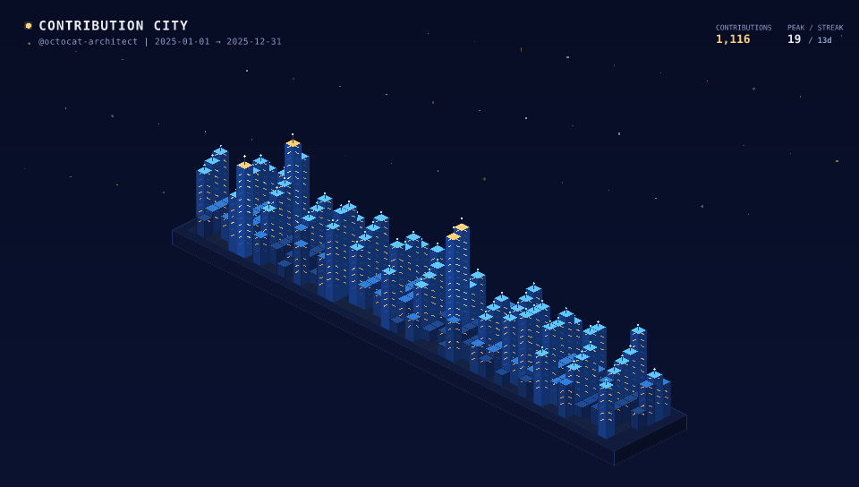
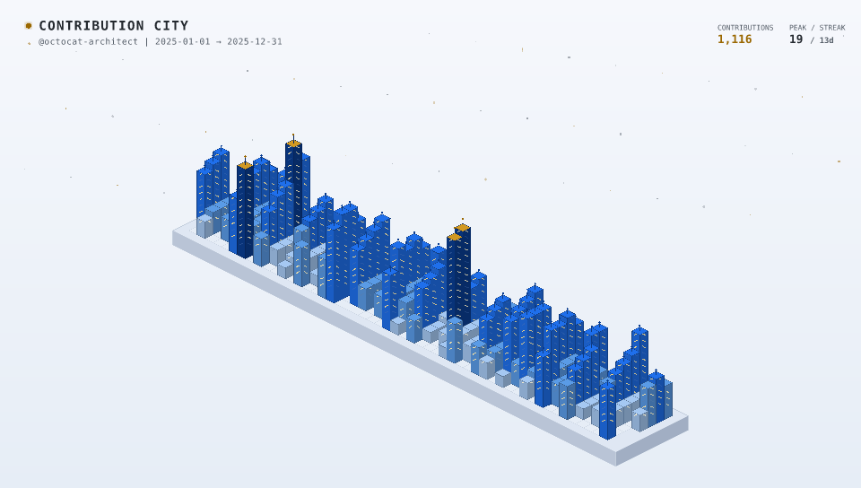

# Contribution City

[](https://github.com/partialHuman/contribution-city/actions)
[](LICENSE)
[](pyproject.toml)

Turn your GitHub contribution activity into an isometric pixel-art city, rendered as one small,
deterministic SVG for profile READMEs and dashboards.

<p align="center">
  
  
</p>

Each day is a building. Busy days grow into towers with lit windows and rooftop beacons.
The same input and options always produce the same file.

## Install

```bash
git clone https://github.com/partialHuman/contribution-city
cd contribution-city
python -m pip install -e ".[dev]"
```

Python 3.10 or newer. The only runtime dependency is `pyyaml`.

## Quick start

```bash
# Offline, from the bundled sample data
contribution-city generate --input examples/sample-contributions.json --output dist/city.svg

# Live data from GitHub (needs a token with read access)
export GITHUB_TOKEN=ghp_xxx
contribution-city generate --username octocat --theme profile --height-mode linear
```

## Command-line options

| Option | Meaning |
|---|---|
| `-i, --input FILE` | Contributions JSON file (offline mode) |
| `-u, --username NAME` | Fetch live data from GitHub |
| `-t, --token TOKEN` | Token; defaults to `GITHUB_TOKEN` / `GH_TOKEN` |
| `-c, --config FILE` | YAML configuration file; command-line options override it |
| `-o, --output FILE` | Output SVG (default `dist/city.svg`) |
| `--theme NAME` | Colour theme, see [Themes](#themes) |
| `--appearance fixed\|auto` | `auto` adds a light palette that follows `prefers-color-scheme` |
| `--layout calendar\|compact` | `calendar` = 53 weeks x 7 days; `compact` = spaced grid |
| `--height-mode power\|linear\|sqrt\|log` | How building height grows with the count |
| `--year YYYY` (repeatable) | Calendar years to include (live data) |
| `--from DATE`, `--to DATE` | Date range, at most one year (live data) |
| `--retries N` | Retries for temporary GitHub failures (default 2) |
| `--width`, `--height`, `--scale` | Canvas size and building height multiplier |
| `--transparent` | No background rectangle or stars |
| `--no-tooltips` | Leave out hover tooltips (smaller file) |
| `--no-fit` | Keep the configured tile size instead of filling the canvas |
| `--smooth` | Anti-aliased edges instead of hard pixel edges |
| `--no-windows`, `--no-stars`, `--no-header`, `--no-platform` | Hide those parts |
| `--title TEXT` | Custom header title |

### Height modes

| Mode | Height above the minimum |
|---|---|
| `power` (default) | grows with `count ** 0.78`, so huge days do not dwarf the rest |
| `linear` | exactly proportional to the day's count (busiest day = maximum height) |
| `sqrt` | proportional to the square root of the count |
| `log` | proportional to `log(1 + count)` |

### Layouts

`calendar` places each day on a GitHub-style grid (columns are weeks, rows are weekdays).
`compact` packs days into a near-square block with one empty tile between buildings.

### Canvas size

By default the city is scaled to fill the canvas, so a bigger `--width` / `--height` gives a
bigger city. Use `--no-fit` for the old fixed tile size.

## Light and dark

GitHub README images need a light and a dark version. There are two ways:

1. **Two files and `<picture>` (works with GitHub's own theme).** Generate `profile` and
   `profile-light` (or `navy-cyan` and `navy-cyan-light`) and switch with HTML:

   ```html
   <picture>
     <source media="(prefers-color-scheme: dark)"  srcset="city-dark.svg">
     <source media="(prefers-color-scheme: light)" srcset="city-light.svg">
     
   </picture>
   ```

2. **One file with `--appearance auto`.** The SVG contains both palettes and switches with the
   viewer's system setting. This is handy for documentation sites, but inside an `` on
   GitHub it follows your operating system, not GitHub's theme choice, so prefer option 1 there.

Themes with a light variant: `navy-cyan` and `profile`.

## Configuration file

See [`examples/config.example.yaml`](examples/config.example.yaml) for every option. Example:

```yaml
username: octocat
theme: profile
appearance: fixed
years: [2024, 2025]
city:
  height_mode: linear
  transparent: true
```

`years` and `from`/`to` cannot be combined. GitHub allows one year per request, so several
years are fetched one by one and merged.

## GitHub Action

Use it from any repository:

```yaml
- uses: partialHuman/contribution-city@v1
  with:
    username: ${{ github.repository_owner }}
    token: ${{ secrets.GITHUB_TOKEN }}
    theme: profile
    height-mode: linear
    transparent: "true"
    output: dist/city.svg
```

A complete daily workflow that publishes to a separate `output` branch (a single commit, so your
history never grows) is in
[`examples/workflows/generate-profile-city.yml`](examples/workflows/generate-profile-city.yml).
Your profile README then points at
`https://raw.githubusercontent.com/OWNER/OWNER/output/city-dark.svg`.

### Inputs

| Input | Default | Notes |
|---|---|---|
| `username` | repository owner | GitHub user |
| `token` | `github.token` | A personal access token with `read:user` also counts private activity |
| `theme` | `navy-cyan` | |
| `layout` | `calendar` | `calendar` or `compact` |
| `appearance` | `fixed` | `fixed` or `auto` |
| `height-mode` | `power` | `power`, `linear`, `sqrt`, `log` |
| `years` | | Comma-separated, for example `2024,2025` |
| `from`, `to` | | `YYYY-MM-DD`, at most one year |
| `transparent` | `false` | |
| `tooltips` | `true` | |
| `auto-fit` | `true` | |
| `retries` | `2` | |
| `config` | | YAML file |
| `input` | | Local JSON file (offline) |
| `output` | `dist/city.svg` | |
| `width`, `height`, `scale` | | Canvas size, height multiplier |

Output: `svg-path`, the path of the generated file.

### Security

- Inputs reach the script only as environment variables, never as pasted shell text.
- The token is read from the environment and is never placed on a command line.
- Pin the action to a tag or commit SHA in your workflow, and pin third-party actions to commit
  SHAs as this repository does.
- Give the workflow only `contents: write`, and only if it pushes.

## Themes

| Theme | Look | Light variant |
|---|---|---|
| `navy-cyan` (default) | Deep navy sky, electric cyan towers | `navy-cyan-light` |
| `profile` | Navy night city, amber windows, gold peaks | `profile-light` |
| `matrix-green` | Phosphor green on black | |
| `sunset-neon` | Synthwave magenta, purple and orange | |
| `monochrome-slate` | Slate and ice white | |
| `solar-amber` | Warm bronze and amber | |

## Data format

`examples/sample-contributions.json` shows the format. The loader also accepts the raw
GitHub GraphQL response and a flat list of `{ "date", "count" }` objects. Private activity is
read from `restrictedContributionsCount` and shown in the header.

## Output notes

- **Size:** the sample year is about 140 KB (about 130 KB without tooltips).
- **Accessibility:** the root element has `role="img"`, a `<title>` and a `<desc>` with your totals.
- **Safety:** every piece of text is escaped, and the output never contains scripts.
- **Deterministic:** no randomness, so unchanged data gives an identical file and no new commit.

## Development

```bash
python -m pip install -e ".[dev]"
pytest
ruff check . && ruff format --check .
```

The tests include a snapshot of a tiny city. After an intended rendering change, refresh it with
`UPDATE_SNAPSHOTS=1 pytest`.

## Contributing

Issues and pull requests are welcome. Please run the tests and Ruff first.

## License

MIT, see [LICENSE](LICENSE).
