# Contribution City

[](https://github.com/partialHuman/contribution-city/actions)
[](LICENSE)
[](pyproject.toml)

Turn your GitHub contribution activity into an isometric pixel-art city, rendered as one small,
deterministic SVG for profile READMEs and dashboards. Each day is a building; busy days grow into
taller buildings.

<p align="center">
  
</p>

> **Version note:** this working tree is the **1.3.0** release candidate; the published release is
> 1.2.0. **1.3.0 changes the default building height** (see [Upgrading](#upgrading-from-120)).
> Everything else keeps its defaults. [CHANGELOG](CHANGELOG.md) |
> [Customization guide](examples/README.md) | [Preview gallery](previews/README.md)

## Install

```bash
git clone https://github.com/partialHuman/contribution-city
cd contribution-city
python -m pip install -e ".[dev]"      # tests, lint and the visual tools
# or, just the tool:  python -m pip install -e .
```

Python 3.10 or newer. The only runtime dependency is `pyyaml`; `resvg-py` and `Pillow` (the `visual`
extra, included in `[dev]`) are needed only for the visual regression tools.

## Quick start

```bash
# Offline, from the bundled sample data (default: standard heights, detailed buildings)
contribution-city generate --input examples/sample-contributions.json --output dist/city.svg

# Another look: theme, layout, solid buildings and a lower camera
contribution-city generate --input examples/sample-contributions.json \
  --theme cyberpunk --layout downtown --building-style solid --view-angle low

# Live data from GitHub (needs a token with read access)
export GITHUB_TOKEN=ghp_xxx
contribution-city generate --username octocat --theme profile --year 2025
```

Output directories are created automatically. Want to use it in your own repository? Follow the
step-by-step [customization guide](examples/README.md); it has copy-paste workflows.

## Preview gallery

Every image below is a real SVG generated by the renderer from the same deterministic sample data
(see [`previews/`](previews/README.md); regenerate with `contribution-city previews --readme README.md`).
Click an image to open the SVG. Under each image is the flag that produced it.

### 1. Themes

Fourteen themes, default settings. Every theme is plain data, see
[`renderer/palettes.py`](src/contribution_city/renderer/palettes.py). Light variants exist for
`navy-cyan` (`navy-cyan-light`) and `profile` (`profile-light`).

<!-- previews:themes:start -->
<table>
<tr><td align="center" valign="top" width="25%"><a href="previews/themes/navy-cyan.svg"></a><br><sub><b>navy-cyan</b><br><code>--theme navy-cyan</code></sub></td><td align="center" valign="top" width="25%"><a href="previews/themes/matrix-green.svg">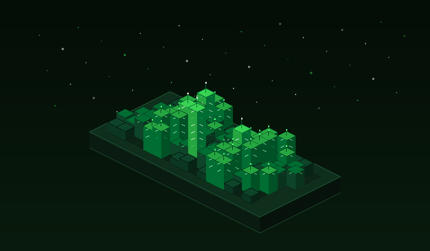</a><br><sub><b>matrix-green</b><br><code>--theme matrix-green</code></sub></td><td align="center" valign="top" width="25%"><a href="previews/themes/sunset-neon.svg">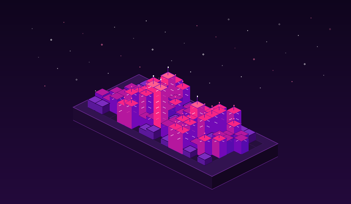</a><br><sub><b>sunset-neon</b><br><code>--theme sunset-neon</code></sub></td><td align="center" valign="top" width="25%"><a href="previews/themes/monochrome-slate.svg">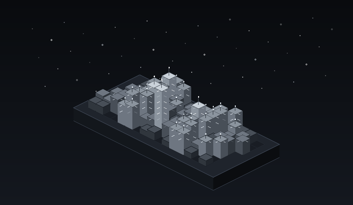</a><br><sub><b>monochrome-slate</b><br><code>--theme monochrome-slate</code></sub></td></tr>
<tr><td align="center" valign="top" width="25%"><a href="previews/themes/solar-amber.svg"></a><br><sub><b>solar-amber</b><br><code>--theme solar-amber</code></sub></td><td align="center" valign="top" width="25%"><a href="previews/themes/profile.svg"></a><br><sub><b>profile</b><br><code>--theme profile</code></sub></td><td align="center" valign="top" width="25%"><a href="previews/themes/profile-light.svg">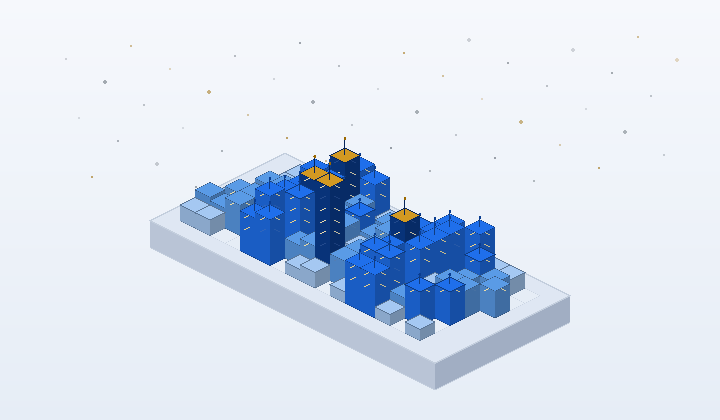</a><br><sub><b>profile-light</b><br><code>--theme profile-light</code></sub></td><td align="center" valign="top" width="25%"><a href="previews/themes/navy-cyan-light.svg">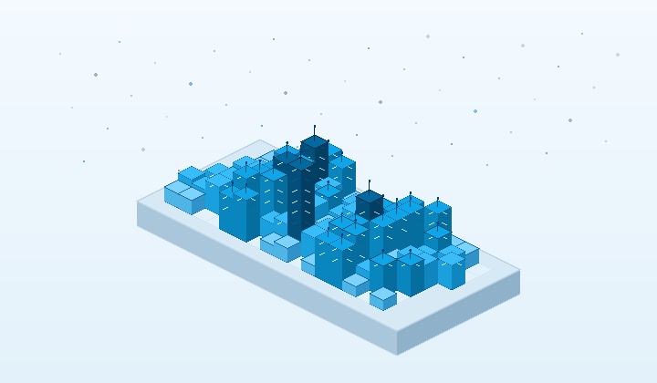</a><br><sub><b>navy-cyan-light</b><br><code>--theme navy-cyan-light</code></sub></td></tr>
<tr><td align="center" valign="top" width="25%"><a href="previews/themes/neon-harbor.svg"></a><br><sub><b>neon-harbor</b><br><code>--theme neon-harbor</code></sub></td><td align="center" valign="top" width="25%"><a href="previews/themes/cyberpunk.svg">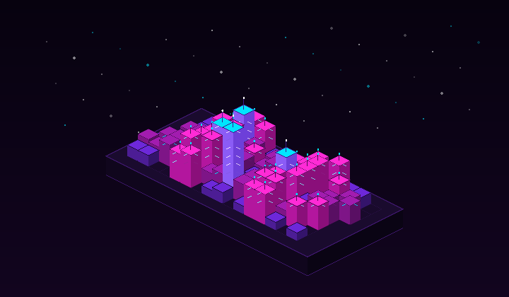</a><br><sub><b>cyberpunk</b><br><code>--theme cyberpunk</code></sub></td><td align="center" valign="top" width="25%"><a href="previews/themes/emerald-matrix.svg">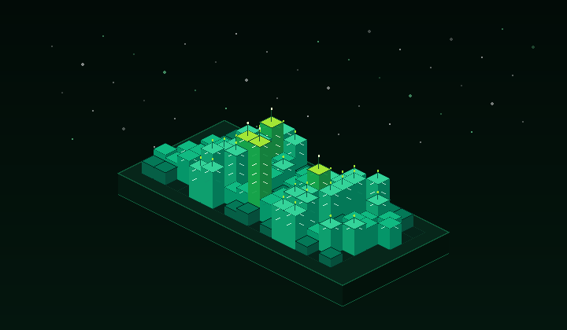</a><br><sub><b>emerald-matrix</b><br><code>--theme emerald-matrix</code></sub></td><td align="center" valign="top" width="25%"><a href="previews/themes/copper-forge.svg">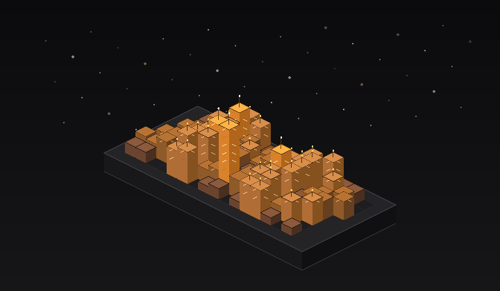</a><br><sub><b>copper-forge</b><br><code>--theme copper-forge</code></sub></td></tr>
<tr><td align="center" valign="top" width="25%"><a href="previews/themes/arctic-glass.svg"></a><br><sub><b>arctic-glass</b><br><code>--theme arctic-glass</code></sub></td><td align="center" valign="top" width="25%"><a href="previews/themes/sunset-grid.svg">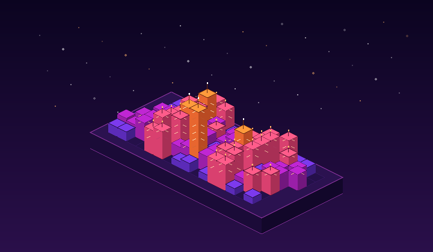</a><br><sub><b>sunset-grid</b><br><code>--theme sunset-grid</code></sub></td><td width="25%"></td><td width="25%"></td></tr>
</table>
<!-- previews:themes:end -->

### 2. Layouts

<!-- previews:layouts:start -->
<table>
<tr><td align="center" valign="top" width="25%"><a href="previews/themes/navy-cyan.svg"></a><br><sub><b>calendar</b><br><code>--layout calendar</code></sub><br><sub>same file as <code>themes/navy-cyan.svg</code></sub></td><td align="center" valign="top" width="25%"><a href="previews/layouts/compact.svg"></a><br><sub><b>compact</b><br><code>--layout compact</code></sub></td><td align="center" valign="top" width="25%"><a href="previews/layouts/dense-grid.svg"></a><br><sub><b>dense-grid</b><br><code>--layout dense-grid</code></sub></td><td align="center" valign="top" width="25%"><a href="previews/layouts/downtown.svg">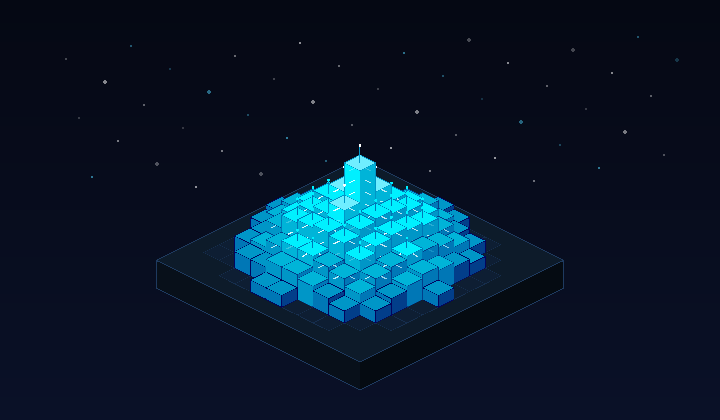</a><br><sub><b>downtown</b><br><code>--layout downtown</code></sub></td></tr>
<tr><td align="center" valign="top" width="25%"><a href="previews/layouts/floating-island.svg"></a><br><sub><b>floating-island</b><br><code>--layout floating-island</code></sub></td><td align="center" valign="top" width="25%"><a href="previews/layouts/wireframe.svg"></a><br><sub><b>wireframe</b><br><code>--layout wireframe</code></sub></td><td width="25%"></td><td width="25%"></td></tr>
</table>
<!-- previews:layouts:end -->

| Layout | What it does |
|---|---|
| `calendar` (default) | GitHub grid: columns are weeks, rows are weekdays |
| `compact` | Square block with one empty tile between buildings |
| `dense-grid` | Square block without gaps: the smallest footprint, good for small embeds |
| `downtown` | Busiest days in the centre (not in date order; tooltips keep the dates) |
| `floating-island` | Dense block on a thick slab with a tapering rock underside and a shadow |
| `wireframe` | Outlined schematic; hidden lines stay hidden |

### 3. Heights and viewing angles

Two different settings decide how tall the buildings are. Do not mix them up:

| Setting | Decides | Values | Default |
|---|---|---|---|
| **Height preset** `--height-preset` | The overall height **profile**: how tall the tallest building may get | `standard`, `tall`, `custom` | `standard` |
| **Height mode** `--height-mode` | The **curve**: how a day's contribution count turns into a height inside that profile | `power`, `linear`, `sqrt`, `log` | `power` |

Preset first, curve second. *Standard* keeps buildings proportionate (at most about three tiles
high); *tall* is the look of versions 1.0 to 1.2 (up to seven tiles); *custom* uses your own
`--scale`, `--min-building-height` and `--max-building-height`.

#### Height presets

<!-- previews:heights-presets:start -->
<table>
<tr><td align="center" valign="top" width="33%"><a href="previews/heights/standard.svg"></a><br><sub><b>standard (default)</b><br><code>--height-preset standard</code></sub></td><td align="center" valign="top" width="33%"><a href="previews/heights/tall-custom.svg">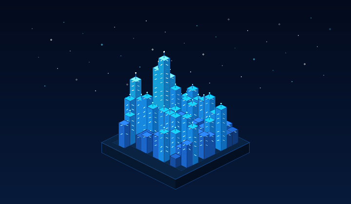</a><br><sub><b>tall</b><br><code>--height-preset tall</code></sub></td><td align="center" valign="top" width="33%"><a href="previews/heights/custom-scale-1-5-max-90.svg"></a><br><sub><b>custom: scale 1.5, max 90</b><br><code>--height-preset custom --scale 1.5 --max-building-height 90</code></sub></td></tr>
</table>
<!-- previews:heights-presets:end -->

#### Height modes with the standard preset

<!-- previews:heights-standard-modes:start -->
<table>
<tr><td align="center" valign="top" width="25%"><a href="previews/heights/standard.svg"></a><br><sub><b>power (default curve)</b><br><code>--height-mode power</code></sub></td><td align="center" valign="top" width="25%"><a href="previews/heights/standard-linear.svg"></a><br><sub><b>linear</b><br><code>--height-mode linear</code></sub></td><td align="center" valign="top" width="25%"><a href="previews/heights/standard-sqrt.svg"></a><br><sub><b>sqrt</b><br><code>--height-mode sqrt</code></sub></td><td align="center" valign="top" width="25%"><a href="previews/heights/standard-log.svg"></a><br><sub><b>log</b><br><code>--height-mode log</code></sub></td></tr>
</table>
<!-- previews:heights-standard-modes:end -->

#### Height modes with the tall preset

<!-- previews:heights-tall-modes:start -->
<table>
<tr><td align="center" valign="top" width="25%"><a href="previews/heights/tall-custom.svg"></a><br><sub><b>power (default curve)</b><br><code>--height-mode power</code></sub></td><td align="center" valign="top" width="25%"><a href="previews/heights/tall-linear.svg">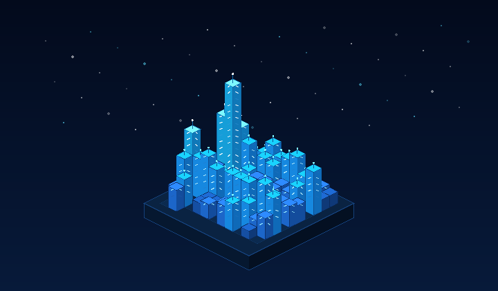</a><br><sub><b>linear</b><br><code>--height-mode linear</code></sub></td><td align="center" valign="top" width="25%"><a href="previews/heights/tall-sqrt.svg"></a><br><sub><b>sqrt</b><br><code>--height-mode sqrt</code></sub></td><td align="center" valign="top" width="25%"><a href="previews/heights/tall-log.svg"></a><br><sub><b>log</b><br><code>--height-mode log</code></sub></td></tr>
</table>
<!-- previews:heights-tall-modes:end -->

| Mode | Height above the minimum |
|---|---|
| `power` | grows with `count ** 0.78`, so huge days do not dwarf the rest |
| `linear` | exactly proportional to the day's count (the busiest day reaches the preset maximum) |
| `sqrt` | proportional to the square root of the count |
| `log` | proportional to `log(1 + count)` |

#### Building styles

`--building-style detailed` (default) draws windows and rooftop beacons. `--building-style solid`
draws plain boxes with three shades (roof, left wall, right wall): no windows, no antennas, no
outlines. It works with every theme, layout, preset and view.

<!-- previews:building-styles:start -->
<table>
<tr><td align="center" valign="top" width="50%"><a href="previews/building-styles/detailed.svg">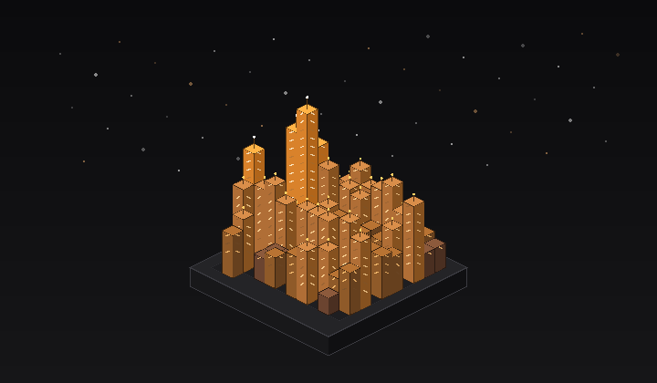</a><br><sub><b>detailed</b><br><code>--building-style detailed</code></sub></td><td align="center" valign="top" width="50%"><a href="previews/building-styles/solid.svg">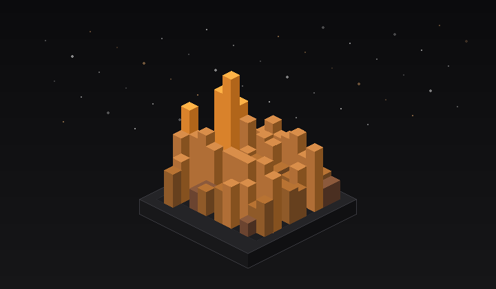</a><br><sub><b>solid</b><br><code>--building-style solid</code></sub></td></tr>
</table>
<!-- previews:building-styles:end -->

#### Viewing angles

The camera elevation changes the projection: a lower camera flattens the ground and makes buildings
read taller, a higher camera shows more ground and shortens them. The default `isometric` view is
the classic 2:1 pixel projection of every earlier release.

| `--view-angle` | Elevation | Look |
|---|---|---|
| `isometric` (default) | 30 deg | Classic pixel isometric |
| `low` | 20 deg | Flatter ground, towers read taller |
| `high` | 42 deg | More ground, buildings look shorter |
| `top-down` | 58 deg | Steep, almost a plan view |

For anything in between use `--view-elevation DEGREES` (10 to 70; it overrides `--view-angle`).
The city is always scaled to fit the canvas, so no angle clips it.

<!-- previews:viewing-angles:start -->
<table>
<tr><td align="center" valign="top" width="25%"><a href="previews/viewing-angles/standard-isometric.svg"></a><br><sub><b>isometric (30 deg)</b><br><code>--view-angle isometric</code></sub></td><td align="center" valign="top" width="25%"><a href="previews/viewing-angles/low.svg">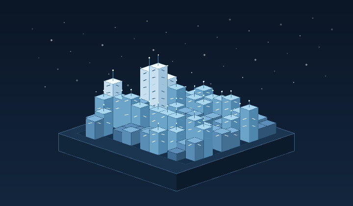</a><br><sub><b>low (20 deg)</b><br><code>--view-angle low</code></sub></td><td align="center" valign="top" width="25%"><a href="previews/viewing-angles/high.svg">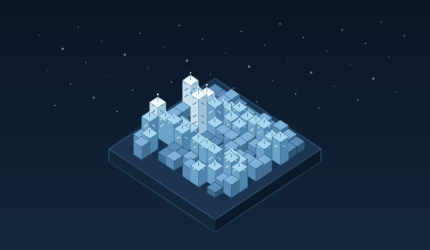</a><br><sub><b>high (42 deg)</b><br><code>--view-angle high</code></sub></td><td align="center" valign="top" width="25%"><a href="previews/viewing-angles/top-down.svg">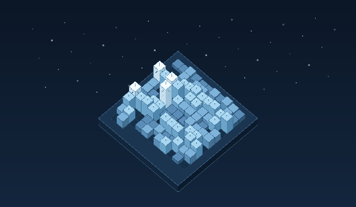</a><br><sub><b>top-down (58 deg)</b><br><code>--view-angle top-down</code></sub></td></tr>
</table>
<!-- previews:viewing-angles:end -->

### 4. Backgrounds

<!-- previews:backgrounds:start -->
<table>
<tr><td align="center" valign="top" width="25%"><a href="previews/backgrounds/solid.svg">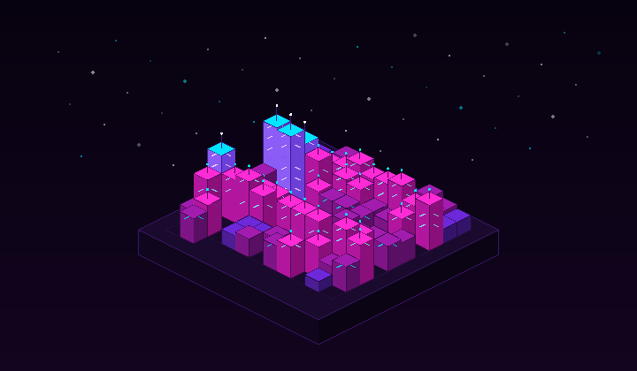</a><br><sub><b>solid</b><br><code>--background solid</code></sub></td><td align="center" valign="top" width="25%"><a href="previews/backgrounds/transparent.svg"></a><br><sub><b>transparent</b><br><code>--background transparent</code></sub></td><td align="center" valign="top" width="25%"><a href="previews/backgrounds/transparent-sky.svg">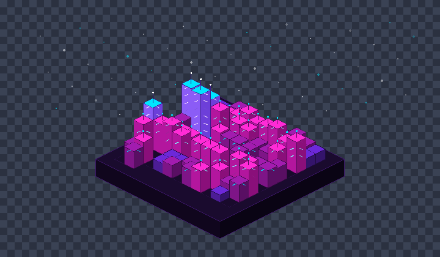</a><br><sub><b>transparent-sky</b><br><code>--background transparent-sky</code></sub></td><td align="center" valign="top" width="25%"><a href="previews/backgrounds/auto-with-auto-appearance.svg">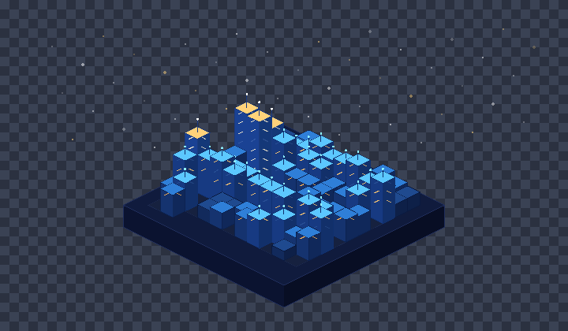</a><br><sub><b>auto + appearance auto</b><br><code>--background auto --appearance auto --theme profile</code></sub><br><sub>Resolves to transparent-sky; carries a dark and a light palette.</sub></td></tr>
</table>
<!-- previews:backgrounds:end -->

GitHub shows a transparent SVG on the page colour, so the transparent previews above sit on a
checkerboard (`*.on-checkerboard.svg`, preview only). The real files in `previews/backgrounds/` stay
transparent.

| `--background` | Result |
|---|---|
| `solid` | The theme's gradient background and sky stars |
| `transparent` | No background rectangle and no stars: the page shows through |
| `transparent-sky` | No background rectangle, but the sky stars stay (they are tuned for dark pages) |
| `auto` | `transparent-sky` when `--appearance auto` is used (the SVG carries a light and a dark palette), otherwise `solid` |

**Legacy flag.** `--transparent` (config `city.transparent`) still works as in 1.1.0 and equals
`--background transparent`. If both are given, **`--background` wins**; a contradictory pair
(`--transparent` with `--background solid`) prints a warning.

## Command-line reference

`contribution-city generate [options]`

| Option | Meaning | Default |
|---|---|---|
| `-i, --input FILE` / `-u, --username NAME` | Offline JSON file, or live GitHub data | |
| `-t, --token TOKEN` | Token | `GITHUB_TOKEN` / `GH_TOKEN` |
| `-c, --config FILE` | YAML configuration file | |
| `-o, --output FILE` | Output SVG | `dist/city.svg` |
| `--theme NAME` | One of the 14 themes | `navy-cyan` |
| `--layout NAME` | `calendar`, `compact`, `dense-grid`, `downtown`, `floating-island`, `wireframe` | `calendar` |
| `--height-preset` | `standard`, `tall`, `custom` | `standard` (see the legacy rule below) |
| `--height-mode` | `power`, `linear`, `sqrt`, `log` | `power` |
| `--scale X` | Multiplier for building heights, 0.1 to 5 | unset |
| `--min-building-height`, `--max-building-height` | Smallest / tallest building in unscaled pixels (0-40 / 8-400) | preset |
| `--building-style` | `detailed`, `solid` | `detailed` |
| `--view-angle` | `isometric`, `low`, `high`, `top-down` | `isometric` |
| `--view-elevation DEG` | Camera elevation 10 to 70, overrides `--view-angle` | unset |
| `--background MODE` | `solid`, `transparent`, `transparent-sky`, `auto` | `solid` |
| `--appearance fixed\|auto` | Add the light palette (themes with a light variant) | `fixed` |
| `--width`, `--height` | Canvas size in pixels (100 to 10000) | 1200 x 680 |
| `--no-fit` | Keep the configured tile size instead of fitting the canvas | fit on |
| `--year YYYY` (repeatable), `--from DATE`, `--to DATE` | Limit the data (a year list and a date range cannot be combined) | all |
| `--retries N` | Retries for temporary GitHub failures | 2 |
| `--id-prefix NAME` | Prefix ids and CSS rules when inlining several SVGs in one page | none |
| `--no-tooltips`, `--smooth` | Smaller file, anti-aliased edges | tooltips on |
| `--no-windows`, `--no-stars`, `--no-header`, `--no-platform` | Hide those parts | shown |
| `--title TEXT` | Custom header title | |
| `--version`, `--help` | Print the version / the full help with examples | |
| `--transparent` | Legacy, see [Backgrounds](#4-backgrounds) | |

Other commands: `previews`, `gallery`, `visual list|check|approve`, `check-svg`. Exit status: `0`
success, `1` error or failed check, `2` usage error (also `visual approve` without `--yes`).
**Precedence:** built-in defaults < configuration file < command-line options. Every key of the
configuration file is documented in [`examples/config/all-options.yaml`](examples/config/all-options.yaml).

**The height rule for old configurations.** If you set `--scale`, `--min-building-height` or
`--max-building-height` (or the same keys in YAML) **without** a `--height-preset`, the preset is
`custom`, which is the 1.2.0 look. Your explicit numbers are never reinterpreted. With an explicit
preset, `--scale` simply scales that preset.

## GitHub Action

```yaml
- uses: partialHuman/contribution-city@v1
  with:
    username: ${{ github.repository_owner }}
    token: ${{ secrets.GITHUB_TOKEN }}
    theme: cyberpunk
    layout: dense-grid
    building-style: solid
    view-angle: high
    background: transparent
    output: dist/city.svg
```

| Input | Default | Accepted values |
|---|---|---|
| `username` | repository owner | GitHub user |
| `token` | `github.token` | token; a personal access token with `read:user` also counts private activity |
| `theme` | `navy-cyan` | any of the 14 themes |
| `layout` | `calendar` | `calendar`, `compact`, `dense-grid`, `downtown`, `floating-island`, `wireframe` |
| `height-preset` | empty = `standard` | `standard`, `tall`, `custom` |
| `height-mode` | `power` | `power`, `linear`, `sqrt`, `log` |
| `scale` | empty | 0.1 to 5 |
| `min-building-height`, `max-building-height` | empty | 0-40, 8-400 |
| `building-style` | `detailed` | `detailed`, `solid` |
| `view-angle` | `isometric` | `isometric`, `low`, `high`, `top-down` |
| `view-elevation` | empty | 10 to 70 degrees (overrides `view-angle`) |
| `background` | empty = `solid` | `solid`, `transparent`, `transparent-sky`, `auto` |
| `transparent` | `false` | legacy; ignored when `background` is set |
| `appearance` | `fixed` | `fixed`, `auto` |
| `width`, `height` | empty = 1200 x 680 | 100 to 10000 |
| `auto-fit`, `tooltips` | `true` | `true`, `false` |
| `years`, `from`, `to` | empty | `2024,2025`, `YYYY-MM-DD` |
| `retries` | `2` | 0 to 10 |
| `id-prefix`, `config`, `input` | empty | prefix, YAML path, JSON path (offline) |
| `output` | `dist/city.svg` | path; parent folders are created |

Output: `svg-path`, the path of the generated file. The action checks `layout`, `appearance`,
`background`, `height-mode`, `height-preset`, `building-style` and `view-angle` before doing any work.

Ready-to-adapt workflows (all third-party actions pinned to commit SHAs) are in
[`examples/workflows/`](examples/workflows/), explained step by step in the
[customization guide](examples/README.md).

Security: inputs reach the script only as environment variables (never pasted into shell text), the
token is never put on a command line or printed.

## Visual testing and the gallery

```bash
contribution-city previews --readme README.md      # the browsable previews/ folder and the grids above
contribution-city previews --check --readme README.md   # fail if previews or grids are out of date
contribution-city gallery --output-dir gallery     # PNG contact sheet and manifest of all test cases
contribution-city visual check                     # compare with approved baselines (never writes them)
contribution-city visual approve --yes --case theme-cyberpunk    # explicit, after reviewing
```

The guide for tolerances, failure artifacts and adding themes is
[docs/visual-testing.md](docs/visual-testing.md).

## SVG quality

Every generated SVG is checked (`contribution-city check-svg`, and the test suite) for well-formed
XML, unique ids, resolving references, no external resources (`http(s)`, `@import`, `<image>`,
`<use>`, `<foreignObject>`), no scripts or event handlers, a `viewBox` equal to `width`/`height`, and
`role="img"` with a `<title>` and `<desc>`. All user-controlled text is escaped. This is a technical
check, **not an accessibility audit**.

## Data format

`examples/sample-contributions.json` shows the format. The loader also accepts the raw GitHub GraphQL
response and a flat list of `{ "date", "count" }` objects. Private activity is read from
`restrictedContributionsCount` and shown in the header.

## Upgrading from 1.2.0

**What changes for you**

- **The default building height is lower.** New default: `--height-preset standard`. To get exactly
  the old look, add `--height-preset tall` (action input `height-preset: tall`, YAML
  `city.height_preset: tall`). SVGs are otherwise byte-identical for the same options (tested).
- **Configurations that set `building_scale`, `min_building_height` or `max_building_height` keep
  their old look** (they become preset `custom`). Nothing you set explicitly is reinterpreted.
- The city now always fits on very small canvases (before, below about 50 % scale it could overflow).

**What is new:** `height-preset`, `building-style`, `view-angle`, `view-elevation`,
`min-building-height`, `max-building-height`, the `previews` command, the preview gallery and the
examples folder. Defaults of all other options, the theme names, the layout names, the height modes
and the background behaviour are unchanged.

## Known limitations

- `appearance=auto` exists for `navy-cyan` and `profile` only.
- The camera presets change the elevation of a symmetric projection. An oblique projection (a camera
  that is not at 45 degrees to the grid) is not implemented.
- `downtown` is not chronological.
- On a transparent background, `wireframe` fills faces with the theme's lower background colour to
  hide lines behind them; choose a theme close to your page colour.
- `--no-fit` with a steep or low angle can leave the city outside the canvas; the default fit cannot.
- The preview SVGs use the dark `solid`/`transparent` themes; light-page rendering is covered by the
  `*-light` themes. Browser handling of `prefers-color-scheme` inside `` was not tested.
- Visual baselines come from one renderer (resvg 0.5.x) and are compared on Linux in CI.

## Development

```bash
python -m pip install -e ".[dev]"
pytest                                  # everything
pytest -m "not baseline"                # without the pixel comparison
ruff check . && ruff format --check .
pip wheel . --no-deps -w wheelhouse     # package build
contribution-city previews --check --readme README.md
```

## License

MIT, see [LICENSE](LICENSE).
