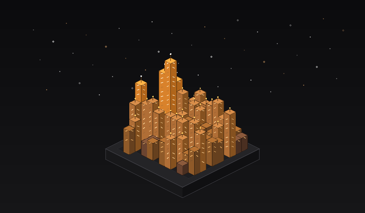

# Customization guide

A complete walk-through for adding a Contribution City to your own GitHub repository, changing how
it looks, and showing it on your profile. No GitHub Actions or Python knowledge is assumed.
Everything in the code blocks is copy-paste ready and uses only options that exist.

**Contents**
1. [What Contribution City generates](#1-what-contribution-city-generates)
2. [Add it to your repository](#2-add-it-to-your-repository)
3. [Create the workflow](#3-create-the-workflow)
4. [Run it](#4-enable-the-workflow-and-run-it)
5. [Theme](#5-choose-a-theme) | 6. [Layout](#6-choose-a-layout)
7. [Heights: standard or tall](#7-standard-or-tall-buildings) | 8. [Custom heights](#8-customize-building-height-safely) | 9. [Height modes](#9-height-modes)
10. [Building style](#10-detailed-or-solid-buildings) | 11. [Viewing angle](#11-viewing-angles) | 12. [Background](#12-backgrounds)
13. [Size](#13-size-width-height-scale-auto-fit) | 14. [Output path](#14-output-path)
15. [Commit or artifact](#15-commit-the-svg-or-upload-it-as-an-artifact) | 16. [Show it in your profile](#16-show-it-in-your-profile-readme)
17. [Private contributions](#17-private-contributions-and-token-permissions) | 18. [Troubleshooting](#18-common-failures-and-how-to-diagnose-them)
19. [Every option](#19-every-option-with-accepted-values-and-defaults)

Ready-made files: [`workflows/`](workflows/) (GitHub Actions) and [`config/`](config/) (YAML
configurations). A browsable gallery of every option is in [`../previews/`](../previews/README.md).

---

## 1. What Contribution City generates

One **SVG image file**. Each day of your GitHub activity becomes a building on an isometric
(pixel-art style) city grid: more contributions, taller building. The file is small, needs no
JavaScript, and works in a README, a web page or a slide.

<p align="center">
  
  
</p>

You can run it three ways: as a **GitHub Action** (recommended, this guide), as a **command-line
tool** (`contribution-city generate ...`), or from **Python** (`CityRenderer`).

## 2. Add it to your repository

Use any repository you own. For a profile README, use the special repository named exactly like your
username (for example `octocat/octocat`); it must be public. Nothing else needs installing: the
action installs everything it needs on GitHub's servers.

## 3. Create the workflow

A workflow is a YAML file in the folder `.github/workflows/` of your repository.

1. In your repository on GitHub choose **Add file > Create new file**.
2. Name it `.github/workflows/contribution-city.yml` (typing the slashes creates the folders).
3. Paste this complete workflow (it is [`workflows/basic-city.yml`](workflows/basic-city.yml)):

```yaml
name: Contribution City

on:
  schedule:
    - cron: "17 4 * * *"      # every day at 04:17 UTC
  workflow_dispatch:           # adds a "Run workflow" button

permissions:
  contents: write              # needed because this workflow commits the SVG

concurrency:
  group: contribution-city
  cancel-in-progress: true

jobs:
  generate:
    runs-on: ubuntu-latest
    steps:
      - name: Check out your repository
        uses: actions/checkout@3d3c42e5aac5ba805825da76410c181273ba90b1 # v7.0.1

      - name: Generate the city
        uses: partialHuman/contribution-city@v1
        with:
          username: ${{ github.repository_owner }}
          token: ${{ secrets.GITHUB_TOKEN }}
          output: assets/contribution-city.svg

      - name: Commit the SVG (only when it changed)
        run: |
          git config user.name "github-actions[bot]"
          git config user.email "41898282+github-actions[bot]@users.noreply.github.com"
          git add assets/contribution-city.svg
          if git diff --staged --quiet; then
            echo "The city did not change."
          else
            git commit -m "chore: update contribution city [skip ci]"
            git push
          fi
```

4. Click **Commit changes**.

`partialHuman/contribution-city@v1` always picks the newest 1.x release. To freeze a version use a
tag such as `@v1.3.0` (or a full commit SHA for the strictest setting).

## 4. Enable the workflow and run it

1. Open the **Actions** tab. If GitHub asks, click **I understand my workflows, go ahead and enable them**.
2. Choose **Contribution City** in the left list, then **Run workflow > Run workflow**.
3. After about a minute a green check appears and `assets/contribution-city.svg` exists in your
   repository. From then on it refreshes daily.

If the run fails, see [section 18](#18-common-failures-and-how-to-diagnose-them).

## 5. Choose a theme

Add `theme:` to the `with:` block of the generate step. Only change what you want; every other input
keeps its default.

```yaml
      - uses: partialHuman/contribution-city@v1
        with:
          theme: cyberpunk
```

Themes: `navy-cyan` (default), `matrix-green`, `sunset-neon`, `monochrome-slate`, `solar-amber`,
`profile`, `profile-light`, `navy-cyan-light`, `neon-harbor`, `cyberpunk`, `emerald-matrix`,
`copper-forge`, `arctic-glass`, `sunset-grid`. See them all in the
[theme gallery](../README.md#1-themes).

## 6. Choose a layout

```yaml
          layout: dense-grid
```

`calendar` (default, one column per week), `compact`, `dense-grid` (tight square, good for small
images), `downtown` (busiest days in the middle), `floating-island`, `wireframe`.
[Layout gallery](../README.md#2-layouts).

## 7. Standard or tall buildings

Since 1.3 buildings are **standard height** by default: proportionate to the platform, at most about
three tiles high. The tall towers of versions 1.0 to 1.2 are one setting away:

```yaml
          height-preset: tall        # standard (default) | tall | custom
```

<p align="center">
  
  
</p>

## 8. Customize building height safely

Use the **custom** preset with your own numbers. Every number has limits, and a value outside them
stops the run with a readable message instead of producing a broken image.

```yaml
          height-preset: custom
          scale: "1.4"                  # multiplier, 0.1 to 5
          max-building-height: "90"     # tallest building in unscaled pixels, 8 to 400
          min-building-height: "4"      # smallest building, 0 to 40
```

- On the `standard` or `tall` preset, `scale` simply scales that preset.
- **Old settings are never reinterpreted.** If you set `scale`, `min-building-height` or
  `max-building-height` and do **not** set `height-preset`, you get `custom`, which is the 1.2.0 look.
- `height` (and `--height` on the command line) is the **canvas** height in pixels, not the
  building height. Building heights are controlled by the settings above.

## 9. Height modes

The **preset** says how tall buildings may get. The **mode** says how a day's contributions turn into
a height inside that range.

```yaml
          height-mode: linear         # power (default) | linear | sqrt | log
```

| Mode | Use it when |
|---|---|
| `power` | You want a natural look where huge days do not dwarf the rest (default) |
| `linear` | Height must be exactly proportional to the count; the busiest day is the tallest allowed |
| `sqrt` | A compromise between `power` and `linear` |
| `log` | Quiet days should still stand out |

[Height gallery](../README.md#3-heights-and-viewing-angles).

## 10. Detailed or solid buildings

```yaml
          building-style: solid       # detailed (default) | solid
```

`detailed` draws windows and rooftop beacons. `solid` draws plain boxes shaded in three tones: no
windows, no antennas, no outlines. It works with every theme, layout, preset and view. Ready file:
[`workflows/solid-city.yml`](workflows/solid-city.yml); configuration: [`config/solid.yaml`](config/solid.yaml).

<p align="center">
  
  
</p>

## 11. Viewing angles

```yaml
          view-angle: low             # isometric (default) | low | high | top-down
```

| `view-angle` | Elevation | Look |
|---|---|---|
| `isometric` | 30 deg | The classic view of every earlier release |
| `low` | 20 deg | Flatter ground, towers read taller |
| `high` | 42 deg | More ground, buildings look shorter |
| `top-down` | 58 deg | Steep, almost a plan view |

For any other angle set `view-elevation: "35"` (10 to 70 degrees; it overrides `view-angle`). The
city is always scaled to fit the image, so no angle cuts it off. Compare them all with
[`workflows/heights-and-angles.yml`](workflows/heights-and-angles.yml), which builds every
combination in one run.

## 12. Backgrounds

```yaml
          background: transparent     # solid (default) | transparent | transparent-sky | auto
```

| Value | What you get |
|---|---|
| `solid` | The theme's night-sky gradient and stars |
| `transparent` | No background and no stars: your page shows through |
| `transparent-sky` | No background, but the **stars stay** (nice on dark pages) |
| `auto` | `transparent-sky` when `appearance: auto` is also set, otherwise `solid` |

A transparent SVG looks like the page behind it, so check it on your real page. On a light page use
`transparent` with a theme that has a light variant (`profile-light`, `navy-cyan-light`); the stars
of `transparent-sky` are tuned for dark pages. The older `transparent: "true"` input still works and
means the same as `background: transparent`; if you set both, `background` wins. Ready file:
[`workflows/transparent-city.yml`](workflows/transparent-city.yml).

## 13. Size: width, height, scale, auto-fit

```yaml
          width: "1000"          # canvas width in pixels, 100 to 10000 (default 1200)
          height: "560"          # canvas height in pixels, 100 to 10000 (default 680)
          auto-fit: "true"       # scale the city to fill the canvas (default)
```

A larger canvas gives a larger city, because the city is scaled to fill it. Set `auto-fit: "false"`
only if you want the fixed tile size (a steep or low camera can then leave the canvas). `scale`
changes building **heights**, not the canvas ([section 8](#8-customize-building-height-safely)).
Inputs that are numbers are written in quotes in YAML so they are passed as text.

## 14. Output path

```yaml
          output: assets/contribution-city.svg      # default: dist/city.svg
```

Parent folders are created. The path is also available to later steps as
`${{ steps.<id>.outputs.svg-path }}` when the step has an `id:`.

## 15. Commit the SVG or upload it as an artifact

**Commit it** (a persistent file you can link to): use the commit step of
[`workflows/basic-city.yml`](workflows/basic-city.yml). It needs `permissions: contents: write` and
is safe from loops because the workflow runs only on a schedule or by hand, never on a push.

**Upload it** (a download attached to the run; nothing is committed): needs only read access.

```yaml
permissions:
  contents: read

jobs:
  generate:
    runs-on: ubuntu-latest
    steps:
      - id: city
        uses: partialHuman/contribution-city@v1
        with:
          username: ${{ github.repository_owner }}
          token: ${{ secrets.GITHUB_TOKEN }}
      - uses: actions/upload-artifact@cf430e030ddbb5b0abf93d22962f4752f3646cd9 # v7.0.2
        with:
          name: contribution-city
          path: ${{ steps.city.outputs.svg-path }}
```

Full example with many options: [`workflows/customized-city.yml`](workflows/customized-city.yml).
To keep your main branch clean you can publish to a separate `output` branch instead:
[`workflows/generate-profile-city.yml`](workflows/generate-profile-city.yml) (dark and light version, one
amended commit, no history growth).

## 16. Show it in your profile README

The profile README is `README.md` in the repository named like your username. Pick one of these.

**A. The file is in the same repository** (basic workflow, path `assets/contribution-city.svg`):

```markdown

```

**B. Centered and sized:**

```html
<p align="center">
  
</p>
```

**C. Light and dark versions** (GitHub picks the one that matches the reader's theme; use
[`workflows/generate-profile-city.yml`](workflows/generate-profile-city.yml), which publishes to the
`output` branch):

```html
<picture>
  <source media="(prefers-color-scheme: dark)"  srcset="https://raw.githubusercontent.com/YOUR-NAME/YOUR-NAME/output/city-dark.svg">
  <source media="(prefers-color-scheme: light)" srcset="https://raw.githubusercontent.com/YOUR-NAME/YOUR-NAME/output/city-light.svg">
  
</picture>
```

**D. On another site or repository**, use the raw URL of the committed file:
`https://raw.githubusercontent.com/YOUR-NAME/YOUR-REPO/main/assets/contribution-city.svg`.

You do not need GitHub Pages. If you want a web page anyway, publish the committed file with any
static host and use an `` tag. GitHub caches images for a few minutes, so a refresh can take a
little while to appear.

## 17. Private contributions and token permissions

- `secrets.GITHUB_TOKEN` is created automatically for every run; it sees **public** activity only.
  The workflows here need no other secret.
- To include **private** activity, create a **personal access token** with the `read:user` scope
  (GitHub: Settings > Developer settings > Personal access tokens), and in your repository save it
  under Settings > Secrets and variables > Actions as, for example, `CONTRIBUTIONS_TOKEN`. Then use
  `token: ${{ secrets.CONTRIBUTIONS_TOKEN }}`. Also make sure "Private contributions" is enabled on
  your profile. The city then shows the count of private contributions in its header. GitHub changes
  token screens from time to time; follow its current wording.
- The token is passed to the tool through the environment and is never printed in logs.
- Keep permissions minimal: `contents: read` when you only upload an artifact, `contents: write`
  only when the workflow commits.
- For committing to the default branch, the repository's Settings > Actions > General >
  Workflow permissions must allow writes (or keep `permissions:` in the file, as shown).

## 18. Common failures and how to diagnose them

Open the failed run in the **Actions** tab and expand the red step.

| Message or symptom | Cause and fix |
|---|---|
| `Invalid background` / `Invalid layout` / `Invalid view-angle` ... | A value is misspelled. The message lists the accepted ones; see [section 19](#19-every-option-with-accepted-values-and-defaults). |
| `building_scale must be between 0.1 and 5.0` (and similar) | A number is out of range. The message prints the limits. |
| `requires authentication` | No token. Add `token: ${{ secrets.GITHUB_TOKEN }}`. |
| `GitHub authentication error (HTTP 401/403)` | Token invalid or too weak. Recreate the personal access token with `read:user`. |
| `User '...' not found` | `username` is wrong. For a profile repository `${{ github.repository_owner }}` is right. |
| `rate limit exceeded` | Wait and re-run; the tool already retries temporary failures (`retries`, default 2). |
| `Permission to ... denied` or `403` on `git push` | Add `permissions: contents: write` to the workflow and allow writes under Settings > Actions > General. |
| The city is empty or small | The account has little public activity in the period; see [section 17](#17-private-contributions-and-token-permissions) for private activity, or widen `years` / `from` / `to`. |
| The workflow never runs on its own | Scheduled workflows run only on the default branch and are paused by GitHub after 60 days without repository activity; press **Run workflow** to wake it up. |
| The README still shows the old image | GitHub caches images for a few minutes; hard-refresh, or check that the committed file changed. |
| Image missing in the profile README | The path is wrong or the repository is private. Open the SVG in the repository to check its location. |
| `No such file: examples/...` in your own repository | Use your own `input:`/`config:` paths; the files in this guide live in the Contribution City repository. |

To see exactly what the tool does, run it locally:
`pip install git+https://github.com/partialHuman/contribution-city` then
`contribution-city generate --input examples/sample-contributions.json --output city.svg`.

## 19. Every option with accepted values and defaults

Action inputs (also CLI flags with the same name after `--`, and YAML keys with underscores under
`city:` where noted in [`config/all-options.yaml`](config/all-options.yaml)).

| Input | Default | Accepted values |
|---|---|---|
| `username` | repository owner | GitHub user name |
| `token` | `github.token` | a token |
| `theme` | `navy-cyan` | `navy-cyan`, `matrix-green`, `sunset-neon`, `monochrome-slate`, `solar-amber`, `profile`, `profile-light`, `navy-cyan-light`, `neon-harbor`, `cyberpunk`, `emerald-matrix`, `copper-forge`, `arctic-glass`, `sunset-grid` |
| `layout` | `calendar` | `calendar`, `compact`, `dense-grid`, `downtown`, `floating-island`, `wireframe` |
| `height-preset` | empty (= `standard`) | `standard`, `tall`, `custom` |
| `height-mode` | `power` | `power`, `linear`, `sqrt`, `log` |
| `scale` | empty | 0.1 to 5 |
| `min-building-height` | empty (preset) | 0 to 40 |
| `max-building-height` | empty (preset) | 8 to 400, at least 1 above the minimum |
| `building-style` | `detailed` | `detailed`, `solid` |
| `view-angle` | `isometric` | `isometric`, `low`, `high`, `top-down` |
| `view-elevation` | empty | 10 to 70 (overrides `view-angle`) |
| `background` | empty (= `solid`) | `solid`, `transparent`, `transparent-sky`, `auto` |
| `transparent` | `false` | `true`, `false` (legacy; ignored when `background` is set) |
| `appearance` | `fixed` | `fixed`, `auto` (themes with a light variant: `navy-cyan`, `profile`) |
| `width`, `height` | empty (1200 x 680) | 100 to 10000 |
| `auto-fit` | `true` | `true`, `false` |
| `tooltips` | `true` | `true`, `false` |
| `years` | empty | comma-separated years, for example `2024,2025` |
| `from`, `to` | empty | `YYYY-MM-DD` (at most one year; not together with `years`) |
| `retries` | `2` | 0 to 10 |
| `id-prefix` | empty | letters, digits, `-`, `_`; starts with a letter |
| `config` | empty | path to a YAML file |
| `input` | empty | path to a JSON file (offline mode) |
| `output` | `dist/city.svg` | a file path |

Output: `svg-path`.

Defaults are identical in the command line, YAML and the action. "Empty" means "not set": the
tool then uses the built-in default shown in brackets. Precedence: built-in defaults < YAML file <
action input / command-line option.
