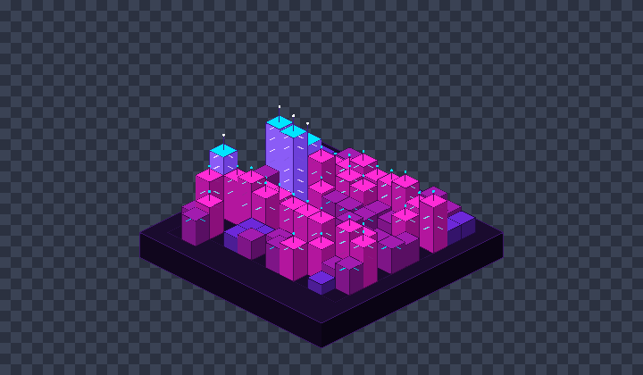

# Backgrounds

solid, transparent, transparent-sky and auto.

Click a preview to open the SVG. Each file was produced by `contribution-city generate` with the flags shown under it (plus `--no-tooltips --no-header`, a 720x420 canvas and the deterministic sample data described in the [gallery index](../README.md)).

<table>
<tr><td align="center" valign="top" width="33%"> <b>solid</b> <code>--background solid</code></td><td align="center" valign="top" width="33%"> <b>transparent</b> <code>--background transparent</code></td><td align="center" valign="top" width="33%"> <b>transparent-sky</b> <code>--background transparent-sky</code></td></tr>
<tr><td align="center" valign="top" width="33%"> <b>auto + appearance auto</b> <code>--background auto --appearance auto --theme profile</code> Resolves to transparent-sky; carries a dark and a light palette.</td><td width="33%"></td><td width="33%"></td></tr>
</table>

[Back to the gallery index](../README.md) | [Customization guide](../../examples/README.md)
