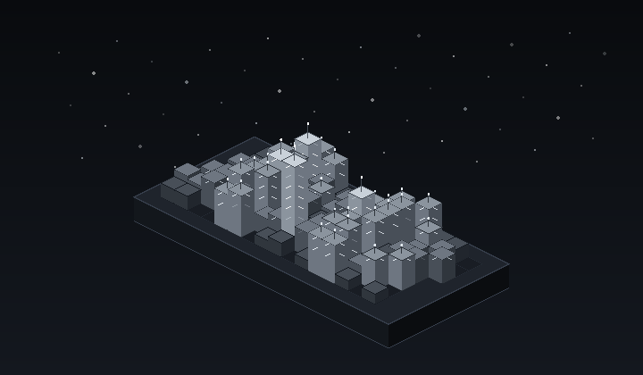
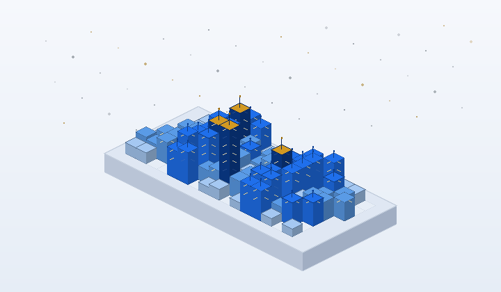
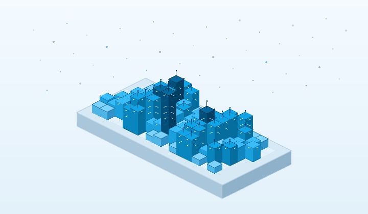
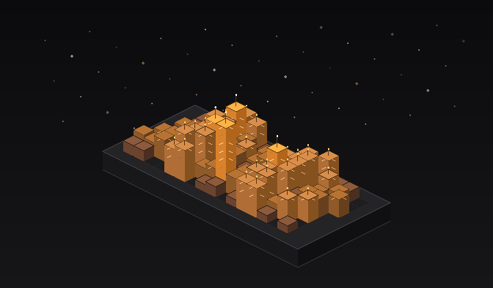

# Themes

Every theme, default settings (calendar layout, standard heights).

Click a preview to open the SVG. Each file was produced by `contribution-city generate` with the flags shown under it (plus `--no-tooltips --no-header`, a 720x420 canvas and the deterministic sample data described in the [gallery index](../README.md)).

<table>
<tr><td align="center" valign="top" width="25%"> <b>navy-cyan</b> <code>--theme navy-cyan</code></td><td align="center" valign="top" width="25%"> <b>matrix-green</b> <code>--theme matrix-green</code></td><td align="center" valign="top" width="25%"> <b>sunset-neon</b> <code>--theme sunset-neon</code></td><td align="center" valign="top" width="25%"> <b>monochrome-slate</b> <code>--theme monochrome-slate</code></td></tr>
<tr><td align="center" valign="top" width="25%"> <b>solar-amber</b> <code>--theme solar-amber</code></td><td align="center" valign="top" width="25%"> <b>profile</b> <code>--theme profile</code></td><td align="center" valign="top" width="25%"> <b>profile-light</b> <code>--theme profile-light</code></td><td align="center" valign="top" width="25%"> <b>navy-cyan-light</b> <code>--theme navy-cyan-light</code></td></tr>
<tr><td align="center" valign="top" width="25%"> <b>neon-harbor</b> <code>--theme neon-harbor</code></td><td align="center" valign="top" width="25%"> <b>cyberpunk</b> <code>--theme cyberpunk</code></td><td align="center" valign="top" width="25%"> <b>emerald-matrix</b> <code>--theme emerald-matrix</code></td><td align="center" valign="top" width="25%"> <b>copper-forge</b> <code>--theme copper-forge</code></td></tr>
<tr><td align="center" valign="top" width="25%"> <b>arctic-glass</b> <code>--theme arctic-glass</code></td><td align="center" valign="top" width="25%"> <b>sunset-grid</b> <code>--theme sunset-grid</code></td><td width="25%"></td><td width="25%"></td></tr>
</table>

[Back to the gallery index](../README.md) | [Customization guide](../../examples/README.md)
